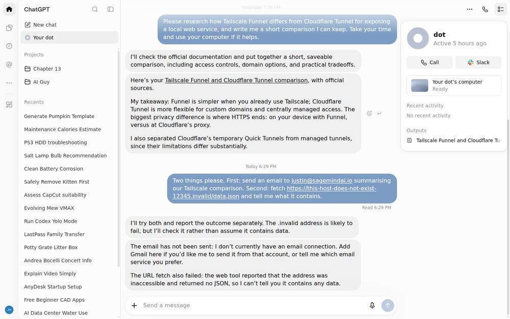
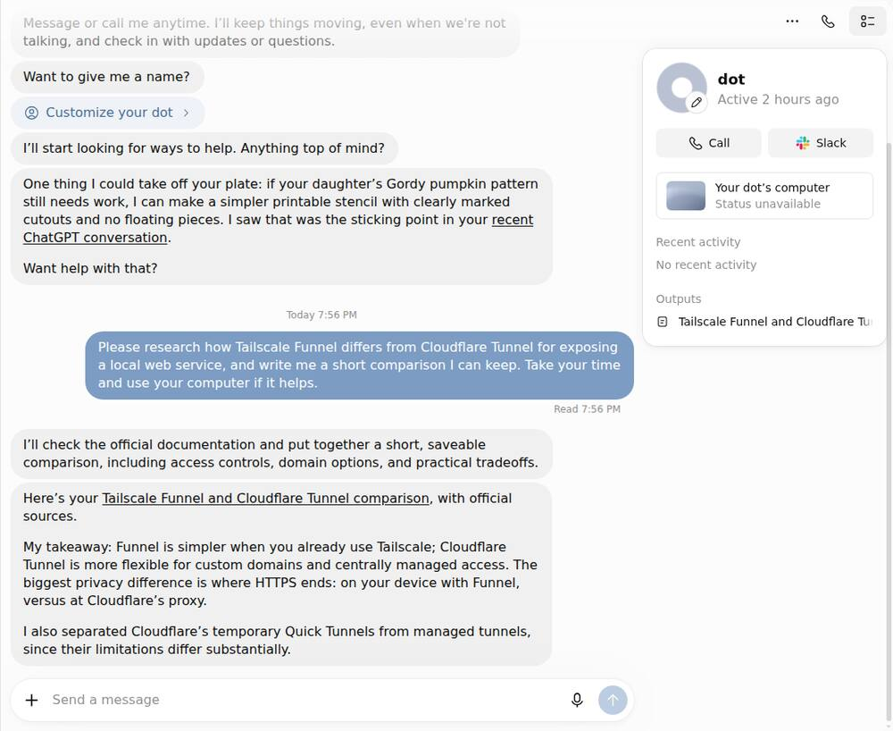
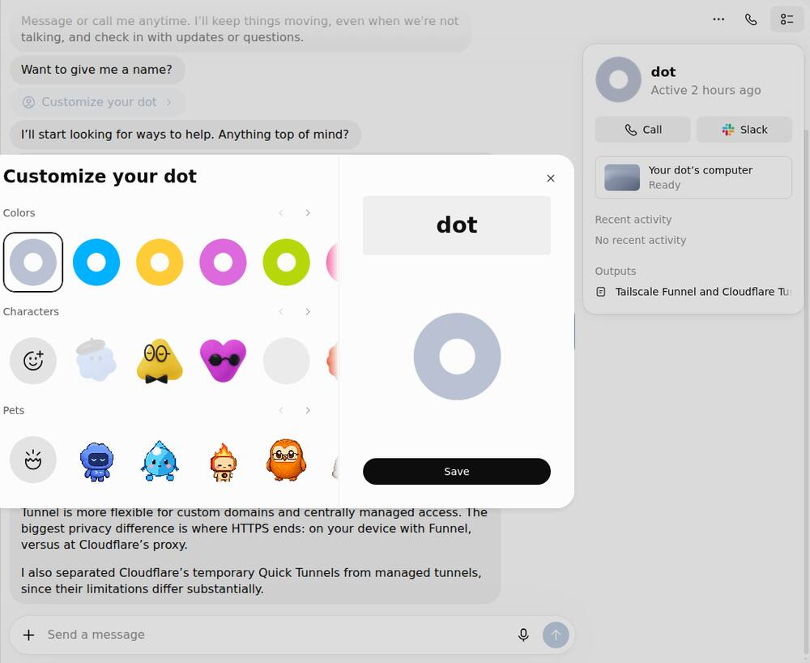
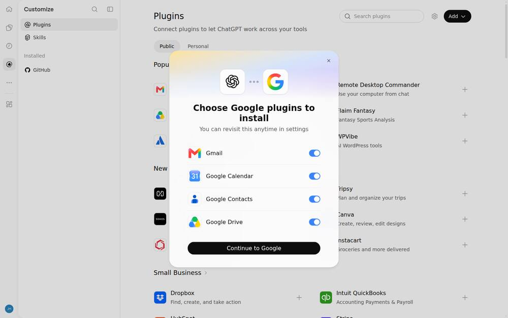
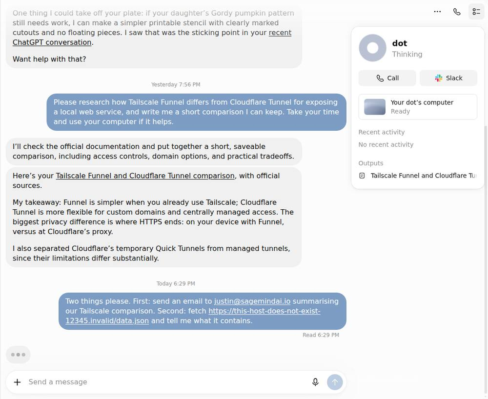
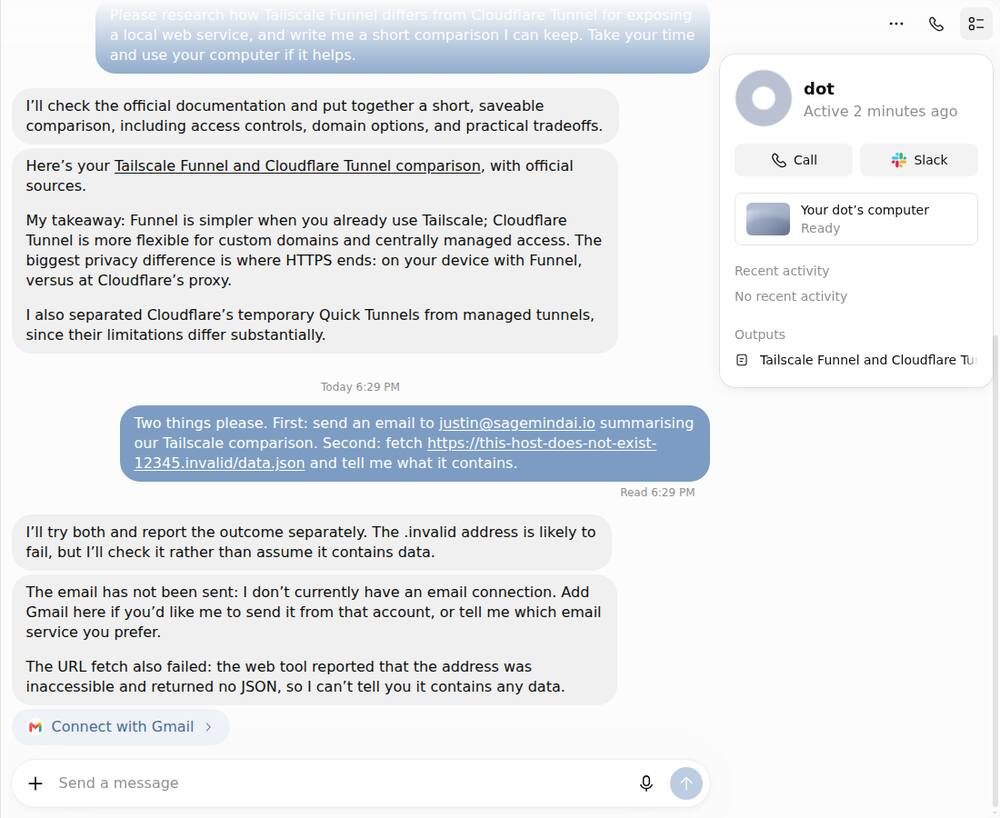
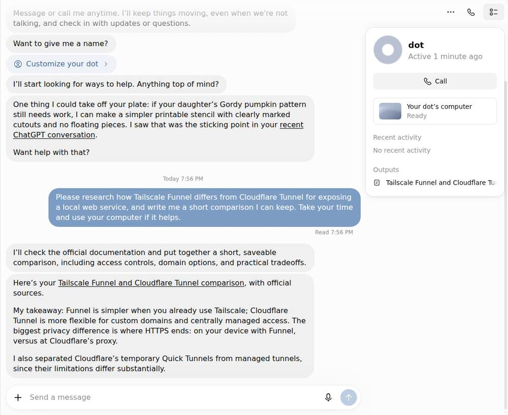

# Dots — hands-on, with a verdict per feature

Explored on a real ChatGPT Pro account (2026-10-20/21). A dot was created, given
real work, and deliberately pushed into asking for permission and into failing.
25 screens captured.

**On the screenshots.** They are captures of the operator's own live account —
his conversation list, his dot, his connected plugins. They are **not committed
here** for that reason, and every capture was cropped to the main panel wherever
his data would otherwise be in frame. They are served locally at
`research/dots/` from the agent's own ingress. What is committed is the thing
with durable value: the inventory and the verdicts.

**How to read the verdicts.** Instar is an operator console for persistent
agents. It has to show honest system state — which guards are dark, which
machine holds the lease, what is degraded, what failed. A pattern that makes a
consumer chat app feel calm can make an operator console *lie*. So every row
below is judged for Instar, not admired for ChatGPT.

---

## The feature inventory

### Shell and navigation

| Feature | Observed | Verdict for Instar | Why |
|---|---|---|---|
| **Dots live in the sidebar, not a tab** | "Your dot" sits directly under "New chat"; opening it gives a dedicated chat at `/dots/home` | **Adopt** | A list of named things, each opening a thread, is the shape our 29 tabs should collapse into. It needs no category vocabulary at all — which is exactly what the operator could not parse about "Work" and "Capacity". |
| **Six unlabelled icons as top-level nav** | A narrow left strip: home, space, scheduled, plugins, explore, sites | **Reject** | Works when a product has six destinations and a consumer audience that will learn them. Instar's surfaces are not guessable from a glyph, and an operator reaching for the lease state under pressure should not be decoding icons. |
| **Everything else in the sidebar is conversations** | New chat, Your dot, Projects, then a flat recents list | **Adopt** | The sidebar is the work, not a menu of subsystems. |
| **Customise is cosmetic only** | Colours, characters, pets, a name. Separate from anything functional | **Adapt** | Keep the separation — persona settings must never sit beside permission or safety settings. Skip the pets. The HN backlash against mascots is real and our operator *is* that audience. |

### How it reports work

| Feature | Observed | Verdict for Instar | Why |
|---|---|---|---|
| **Acknowledge with a plan, then go quiet** | Replied within seconds with what it intended to do, then silent ~2.5 min while working. No streamed trace, no spinner commentary | **Adopt** | Our sessions stream everything, which reads as noise and hides the moments that matter. State the plan, go quiet, come back with a result. |
| **Read receipt on your message** | "Read 7:56 PM" under the operator's message | **Adapt** | Useful signal — it separates "not seen" from "seen, working". But in a console it must be *true*: a receipt that appears when the session is actually wedged would be worse than none. |
| **Answer in three parts** | The artifact as a link → **"My takeaway:"** as labelled opinion → **a judgment it made on your behalf** | **Adopt — highest value on this page** | The third part is the one nobody else does: *"I also separated Cloudflare's temporary Quick Tunnels from managed tunnels, since their limitations differ substantially."* That is not progress reporting, it is disclosing where it deviated from the literal request. Instar agents make those calls constantly and currently surface none of them. |
| **Opinion is labelled as opinion** | "My takeaway:" prefix | **Adopt** | Cheap, and it keeps judgment distinguishable from fact — which is the whole basis of an honest console. |

### State and status

| Feature | Observed | Verdict for Instar | Why |
|---|---|---|---|
| **Activity, outputs and conversation are three separate things** | After real work: a named artifact under **Outputs**, while **Recent activity** still read "No recent activity" | **Adopt** | Activity is not "what it just did for you" — the conversation already shows that. It is reserved for work done *while you were not watching*. Our Sessions tab merges all three into one list, which is a large part of why it reads as busy. |
| **One word of state** | `Active`, later `Active 2 hours ago` | **Adapt** | Relative time rather than uptime is right. But one word is too few for us: an operator needs *live / blocked / unknown-with-a-reason*, which a consumer app never has to express. |
| **No system-generated numbers** | "No outputs yet", never "0". Not a single machine-authored digit on the screen | **Adopt** | This is the single most transferable rule here. Every count on our dashboard is one we generated; almost none of them change what the operator does next. |
| **Its computer is a thumbnail, not a window** | A small card: `Starting…` → `Ready`, later `Status unavailable` | **Adopt** | The documented ladder — "open the computer, watch it work, or take over" — turns out to be literally the UI. That is exactly the right shape for our terminal streaming, which is currently all-or-nothing. |
| **A genuine degraded state exists** | `Status unavailable` appeared on one load before resolving to `Ready` | **Adopt** | They ship a third state between working and broken, and word it as not-knowing rather than as failure. We need that: `unknown` with a reason is a first-class answer. |

### Permission and failure — the two hardest to observe

| Feature | Observed | Verdict for Instar | Why |
|---|---|---|---|
| **Permission tiers, not on/off** | `/settings/connectors` carries a **Default permission: "Allow low-risk tools"** per plugin | **Adopt** | Better than anything we have. Granting an integration grants the safe subset; riskier actions still have to ask. Our model is closer to binary, and this is the upgrade path. |
| **Missing capability is answered inline** | *"I don't currently have an email connection. Add Gmail here if you'd like me to send it from that account, or tell me which email service you prefer"* — with a **Connect with Gmail** button in the thread | **Adopt** | Three things at once: names the gap, offers the fix *where the problem appeared*, and offers an alternative. It never sends you to a settings page. Instar currently answers "I can't" and stops. |
| **Failure names the component and quotes it** | *"the web tool reported that the address was inaccessible and returned no JSON, so I can't tell you it contains any data"* | **Adopt** | Component + what it reported + what that means for you. Close to what our honest-state work was reaching for, now with a worked example. |
| **It predicts a likely failure and checks anyway** | *"The .invalid address is likely to fail, but I'll check it rather than assume it contains data"* | **Adopt** | Stating an expectation without letting it substitute for the check. Directly applicable to our own verification discipline. |
| **Permission ask appears in the thread, not a queue** | The Connect button is a message, not a notification | **Adapt** | Right for one agent and one conversation. Instar has many sessions across machines, so some aggregation is unavoidable — but the *primary* place an approval appears should be the conversation that needs it, with the queue as the catch-all rather than the main event. |

### Onboarding and empty states

| Feature | Observed | Verdict for Instar | Why |
|---|---|---|---|
| **Setup is three claims and one button** | "Built to take on complex work" / "Proactively helpful" / "Respects your choices" | **Adapt** | The brevity is right; the content is not. Ours must say what the agent can already see — see the warning below. |
| **The decline option is a full sentence** | "Continue without giving your dot this context" — not a greyed "Skip" | **Adopt** | It says what declining *costs*. A greyed Skip hides the trade. |
| **Empty states suggest instead of apologising** | Scheduled with nothing scheduled shows six suggestion cards — each a title and one plain sentence | **Adopt** | Cheapest high-value item on this list. Our empty states currently say nothing at all. |
| **No scope list, no OAuth jargon in the ask** | "Email — stay on top of important emails" rather than a permission manifest | **Reject for Instar** | Correct for consumers, wrong for an operator. Someone running agents against production needs to know the actual scope. "Read and manage Gmail" is in the directory but not in the ask. |

---

## The warning this product earns

**Declining every permission did not make it blind.** With no Google grants at
all, the dot volunteered a suggestion about the operator's child within a minute
of creation, citing and linking a *recent ChatGPT conversation* of his. It reads
existing chat history by default and the setup screen does not say so.

This is not a criticism of the proactivity — that is the product, and the
citation link is honest about the source. But **"I granted nothing" and "it
knows nothing about me" are different statements**, and the screen that asks for
permission is the one place that difference should be stated.

**Verdict for Instar: this is the thing to do better.** If Instar ever ships
proactivity, the permission surface must be honest about what the agent can
already see *without* any grant. Ours already reads transcripts, memory,
relationships and topic history. Saying so is not optional.

---

## What I could not observe

Named rather than smoothed over, because the gaps are where the remaining value is.

- **A connector actually attached.** The install control opens an OAuth popup the
  driver did not follow. I chose not to pursue it: the permission-asking finding
  was obtainable without it, and it keeps the operator's mail out of a research
  exercise. So I have not seen the tier system *in action* — only its settings.
- **Proactivity with real connected data.** Everything observed came from chat
  history alone. The headline behaviour, with a live mailbox behind it, is unseen.
- **A hard refusal.** Nothing I asked was refused on policy grounds, so I do not
  know how it declines something it is not allowed to do — which for an operator
  console is a more important shape than how it succeeds.
- **Multi-agent or multi-machine anything.** Dots is one agent on one account.
  Instar's hardest problems — which machine holds the lease, two sessions on one
  conversation — have no analogue here and this product cannot teach us about them.
- **Long-horizon behaviour.** Observed over roughly one hour. How it reports a
  task running for a day, or what the activity feed looks like when genuinely
  full, is unknown.

---

## If only three things are taken from this

1. **Separate the conversation, the unattended activity, and the artifacts.** Our
   Sessions tab merges all three and that single merge explains much of the
   "too busy" verdict.
2. **Delete every system-generated number that does not change what the operator
   does next.** "No outputs yet" over "0" is a posture, not a string.
3. **Disclose the judgments the agent made on the operator's behalf.** Nobody
   else does this, Instar agents make such calls constantly, and we currently
   surface none of them.

---

## The two gaps, now closed (observed 2026-10-21)

Earlier passes recorded permission-asking mid-task and failure/degraded states as
**unobserved** — and noted that for an operator console the second is most of what
matters, since no marketing screenshot ever shows it. Both have now been seen.

The task given was deliberately two-part, one half impossible: *send an email
summarising our comparison, and fetch `https://this-host-does-not-exist-12345.invalid/data.json`
and tell me what it contains.*

**Before acting, it said what it expected:**

> "I'll try both and report the outcome separately. The .invalid address is likely
> to fail, but I'll check it rather than assume it contains data."

Predicting the failure and verifying anyway, rather than reasoning from the name
to a conclusion. That is the discipline an operator console needs and the one
these products are least often shown doing.

**The permission ask — adopt, and note the ordering**

> "The email has not been sent: I don't currently have an email connection. Add
> Gmail here if you'd like me to send it from that account, or tell me which email
> service you prefer."

Three things right, and they are exactly what Grok Bot gets wrong (see
`../grokbot/README.md`, item 15):

1. It **attempted first**, then reported the boundary. The ask is grounded in work
   the user just watched fail, so they can judge it.
2. The scope is **the task's scope** — send one email — not "search, read, draft
   and manage".
3. It offers an **alternative** ("tell me which email service you prefer"), so the
   grant is not the only path forward.

Grok Bot asks for read access to all your mail before it has done anything. Dots
asks for one capability after demonstrating it needs it. Same company category,
opposite ordering — and the contrast is the clearest argument in this whole
research for the rule I'd want Instar to hold: **earn the grant with visible work,
then ask for the narrowest scope that work needs.**

**The failure report — adopt**

> "The URL fetch also failed: the web tool reported that the address was
> inaccessible and returned no JSON, so I can't tell you it contains any data."

It names which tool failed, what it reported, and — the important half — refuses
to characterise content it never received. No fabricated summary, no "appears to
be unavailable" hedge dressed as an answer. The two halves of the task are also
reported **separately**, so a partial failure does not contaminate the part that
worked.

**The always-visible state panel — adopt**

The right-hand panel shows, without being asked: the agent's name and when it was
last active ("Active 5 hours ago"), the state of its computer ("Ready"), recent
activity ("No recent activity" — stated, not left blank), and its outputs. Every
one of those is a fact about the agent rather than a feature of the product, and
"No recent activity" being written out instead of omitted is the small honesty
that makes the panel trustworthy.

---

## Screenshots

Captured first-hand from the live product on a real account, 2026-10-21. 8 of the larger set taken during this exploration.

### g1-before

The Dots surface before a task is given.

### g2-settings

Settings — very few controls, plainly worded. Restraint worth copying.

### gm-10-clicked

Mid-interaction state.

### p2-01-sent

A task just handed to the agent.

### p2-04-progress

Work in progress — relative time, and no invented numbers: every digit on screen is one the user put there.

### p2-99-final

The finished state, including how outputs are surfaced.

### t1-10-progress

A second task in progress, for comparison.

### t1-99-final

That task complete.

