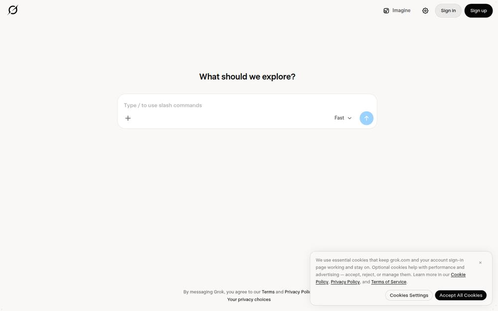
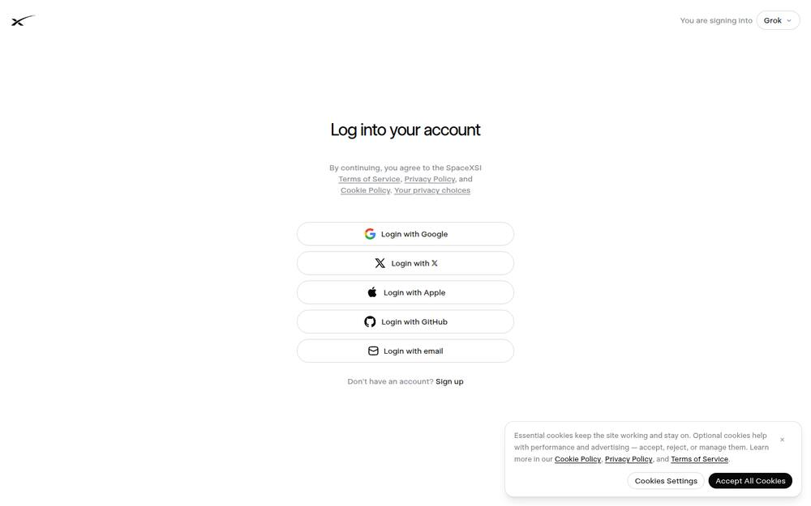
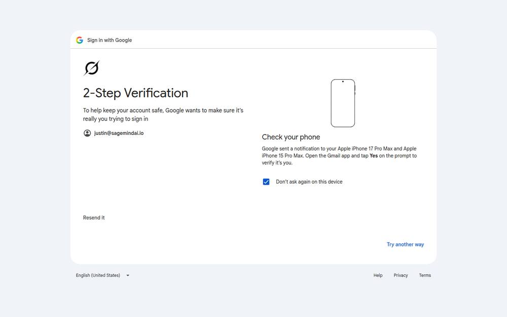
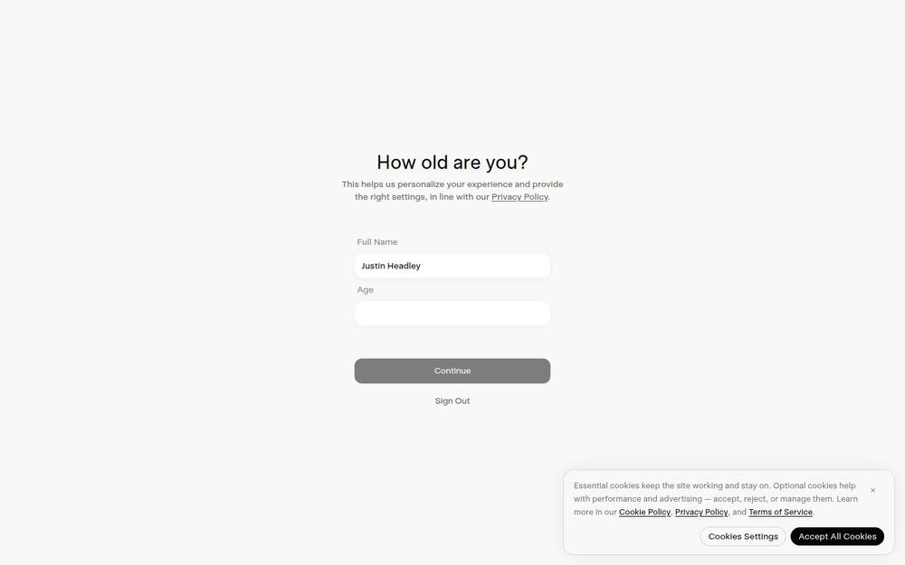
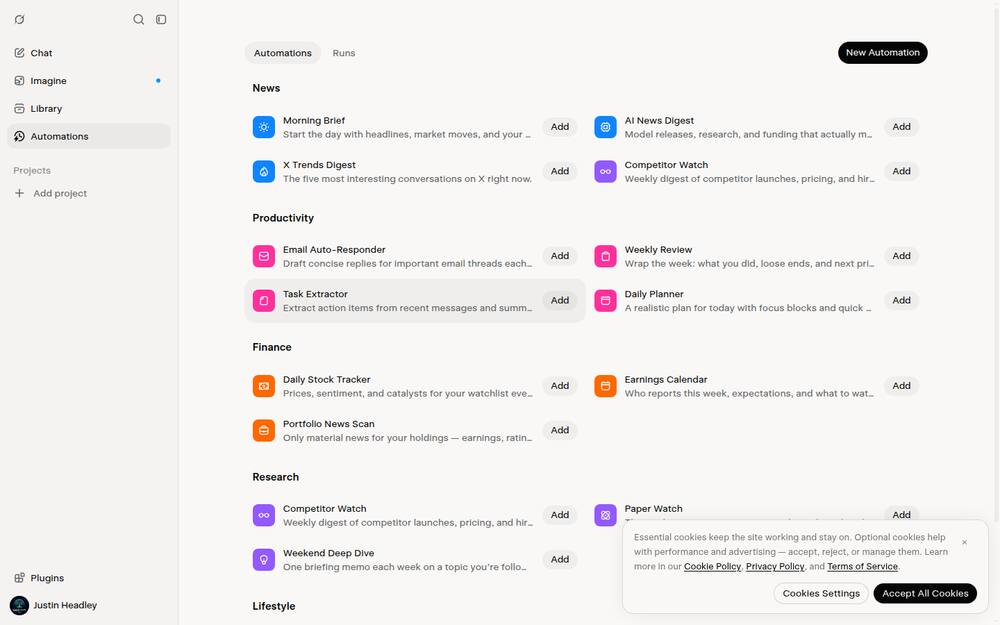
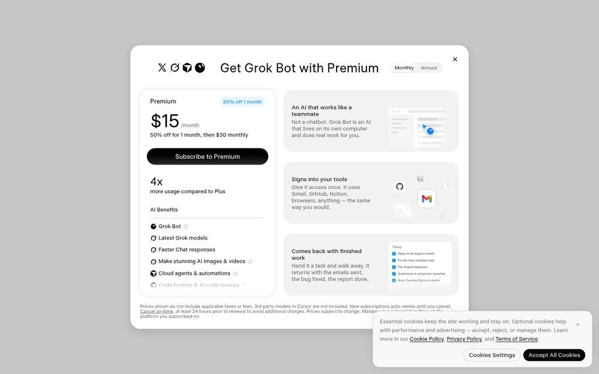

# Grok Bot (xAI) — feature inventory and verdicts

Observed 2026-10-21 from xAI's open documentation set (`x.ai/bot`, `/bot/guides`,
`/bot/use-cases`, `/bot/marketplace`) and the Team Bots launch post, all captured
first-hand with screenshots and full page text. No login required for any of it.

Of the three products studied, Grok Bot is the one whose *shape* most resembles
where Instar already is: not one assistant, but several long-running named agents
with roles, memory, and credentials, working in parallel and reporting back.

---

## What I could and could not observe

**I got inside Grok Bot itself.** The operator's `dawn@sagemindai.io` account
already carried the subscription — which he suspected and I confirmed only after
getting in, having nearly bought a second one. So the product below is observed,
not read about.

**What it took is itself a finding:** Google's sign-in silently discards
keystrokes from an automated browser. Three attempts "failed" with an empty
password box and no error — not a wrong password, not a timeout. Driving a plain
browser with OS-level keystrokes went through first time. Any agent that needs to
operate a real account will hit this, and the failure presents as nothing at all.

**What I deliberately did not do:** the product's first move after onboarding is an
**Authorize** button granting it "search, read, draft, and manage" access to the
operator's Gmail. Clicking that is a third-party data grant, outside what I may do
on his behalf, so it stays unclicked. Everything below is reachable without it.

Marked *(claimed)* = xAI's description of their own product rather than something
I watched work — now limited to the always-working/background behaviour, which no
short session can verify.

---

## Features, with verdicts

### 1. "Take over" / "I'm done, continue" — mid-task control handoff — **adopt. This is the one.**
From the product's own walkthrough: the bot hits something it cannot do —
a login it doesn't hold — and instead of failing or messaging and stopping, it
hands the human the live computer:

> "Sign in to Salesforce so I can see the accounts you own." → **Take over** →
> **I'm done, continue**

The agent pauses *in place*, the human acts *in the agent's own session*, and the
agent resumes with the result. Nothing is re-explained, no credential changes hands,
and the task does not restart.

This is the single most valuable thing in all three products, and I can say that
with unusual confidence because I hit exactly this wall twice while doing this
research — a Google sign-in and an age field — and both times the only move I had
was to send a message and wait. Instar already has every piece needed (a browser
the operator can reach, a dashboard, a tunnel, durable session state) and offers
no such interaction. **Highest-value borrow identified so far.**

### 2. Fleet view — many named agents, each with its last line — **adopt**
The landing surface is a list of agents by role — Chief, Sales Outbound, Inbox
Manager, Talent Scout, Expense Manager — each showing one plain sentence of what
it last did and when ("report filed. 9 receipts, nothing outstanding.").

Instar is *already* multi-session, multi-topic and multi-machine, and has no view
answering "what are all of my agents doing?" This is the Muse "snippet under the
avatar" idea at fleet scale, and it maps directly onto data Instar already holds.

### 3. Unprompted connection self-report — **adopt**
> "Checking what's connected. Hex, Gmail, and LinkedIn are already signed in.
> Salesforce isn't."

The agent volunteers its own capability boundary at the moment of taking work,
before being asked and before failing. Instar has the data behind an endpoint and
a standing rule to check it — but checking is willpower; *volunteering* is design.

### 4. Teach by demonstration — **adapt**
> "Ask a Bot to follow along as you complete a workflow once. It saves it as a
> routine and runs it on its own next time." *(claimed)*

Instar's equivalent of a saved routine is a job definition, which today is written,
not demonstrated. Adapt rather than adopt: the valuable half is that a repeated
workflow becomes a durable artifact *without the user writing a config*.

### 5. Memory updates disclosed in the conversation — **adopt**
> "Noted for next time: they only sign annual, and Dana is the one who approves."
> — *Updated memory for Account Manager*

What was learned is shown at the moment it is learned, attributed to the agent that
learned it. Instar writes memory constantly and silently. This is the cheap fix for
the "approval-forgetting" problem: a standing decision the user can see being
recorded is one they can correct before it hardens.

### 6. The four-part model: Context · Plugins · Credentials · Memories — **adopt as the mental model**
xAI explains what a bot *is* in four nouns. Instar has all four (CLAUDE.md and
skills; MCP servers; the vault and Secret Drop; the memory store) and has never
presented them as one model. For a console whose stated problem is "people don't
know where to start", a four-noun answer to "what is this agent made of" is worth
more than another tab.

### 7. Shared agent, private per-person context — **adapt (relevant to the global dashboard)**
> "Although the Bot is shared, each person's conversations with it remain private.
> The Bot keeps separate context and memories for each user while drawing on the
> skills shared across the team." *(claimed)*

Directly relevant to the global multi-agent dashboard: shared capability, private
conversation. Worth keeping in view as the enrolment model is designed, rather than
retrofitted later.

### 8. Agent renamed to match the job it was given — **adopt (small, cheap)**
> *Renamed to Sales Outbound*

A one-line touch: once a bot's purpose is established, its name reflects it, and
the rename is shown. Instar topics are named by their creator and drift out of
truth immediately.

### 9. Agents collaborating and handing off to each other — **already have, and ours is more honest**
> "Bots keep context and learn from each other. Show one a workflow today, hand
> off the project by Friday." *(claimed)*

Instar's Threadline does this with signed identity, trust levels, delivery receipts
and pairing. No action — but worth noting our version answers "did it actually
arrive?" and theirs, as documented, does not.

### 10. Marketplace of pre-built agents — **reject for now**
Pre-built role agents ("Add to Grok Bot") are a distribution strategy for a product
with many customers. Instar is one operator's fleet. Revisit only if Instar ever
ships to strangers.

### 11. "Works 24/7, comes back when approval is needed" — **already have**
This is PromiseBeacon, the attention queue, and the approval gates. Confirmation of
direction, not a borrow.

### 12. Automations: a gallery of outcomes, grouped by life-category — **adopt. This is the discoverability answer.**
*(observed first-hand)* The Automations tab does not list features or capabilities.
It lists **finished outcomes**, grouped under headings a person recognises — News,
Productivity, Finance, Research, Lifestyle — each one line long, each with a single
**Add** button:

> *Morning Brief* — "Start the day with headlines, market moves, and your weather."
> *Weekly Review* — "Wrap the week: what you did, loose ends, and next priorities."
> *Task Extractor* — "Extract action items from recent messages and summarise."

Instar's scheduler is strictly more capable and currently has **zero jobs defined**,
because nothing anywhere suggests what a job could be. A gallery of one-line
outcomes, grouped by what the operator cares about, converts an empty powerful
feature into an obvious one. Cheap to build — the job definitions are already
declarative JSON.

### 13. Config and history as two tabs: *Automations* | *Runs* — **adopt**
*(observed first-hand)* "What is scheduled" and "what actually happened" are
adjacent but separate. Instar has both bodies of data (job definitions, the job-run
ledger) and surfaces them as neither.

### 14. Five sidebar items — **adopt the restraint**
*(observed first-hand)* The entire signed-in product navigates from five entries:
Chat, Imagine, Library, Automations, Projects — with Plugins and the account tucked
at the bottom edge. This is a product with a cloud agent platform, an image model,
a file library, a scheduler and a plugin system behind **five** words. Our 29 tabs
are not a necessity of having many capabilities.

### 15. The first thing it asks for is your email — **reject, and learn from it**
*(observed first-hand)* Before any work has been done, before the agent has
demonstrated anything, onboarding presents:

> "Connect Gmail and I'll find something I can take care of for you right away.
> Nothing gets sent without your approval." → **[Authorize]** — *Gmail: search,
> read, draft, and manage email.*

This is Muse's named enemy — banner blindness — arriving in practice at xAI. The
ask lands at the point of maximum enthusiasm and minimum context: the user has no
basis yet for judging what the agent will do with it, and the reassurance
("nothing gets sent without your approval") addresses *sending*, which is not what
the scope grants. The scope grants reading everything.

For Instar the lesson is ordering, not wording: **earn the grant with demonstrated
work, then ask for the narrowest scope that work needs.** An agent that has already
done something visible has given the operator a basis for the decision.

### 16. Connectors · Skills · Bots — three catalogues, one pattern — **adopt the pattern**
*(observed first-hand)* Every extension surface is the same gallery: grouped rows,
a one-line description, a single **Add**. Connectors are integrations (Gmail,
Calendar, GitHub, Notion, Stripe, Vercel…), Skills are capabilities (Word, PDF,
Spreadsheets, Presentations), Bots are shareable agents.

The consistency is the point: one interaction shape covers integrations,
capabilities and agents. Instar has all three concepts (MCP servers, skills,
agents) presented three different ways, none of them a catalogue.

### 17. Skill Creator — "build new custom skills through conversation" — **adopt**
*(observed first-hand)* A first-class entry in the Skills catalogue whose whole job
is to produce new skills by talking. This is the concrete form of "teach by
demonstration" (item 4) and the better half of it: the durable artifact is authored
conversationally rather than configured.

Instar's skills are files an agent or operator writes. A conversational path to a
new skill is the difference between a capability the operator *has* and one they
can *extend*.

### 18. The bot is a role you define — **adopt (small)**
*(observed first-hand)* Each bot carries Name, an optional Title ("Research,
marketing, admin") and a Description, defaulting to "A teammate with its own
computer that takes real work off your plate". Bots pin to the sidebar.

Instar topics have names and nothing else. A one-line role on each agent would make
a fleet view (item 2) readable at a glance rather than a list of opaque labels.

---

## The one thing I would steal first

**Take over / I'm done.** It converts the most common hard stop in agent work — a
wall only the human can pass — from "the agent gives up and waits" into a
five-second handoff that keeps the task alive. I can speak to the cost of not
having it: it is what stopped this very research twice tonight.

## The one thing I would not copy

The agent list shows each bot's last line and nothing about whether it is *stuck*.
Every status in the marketing material is a success ("sent", "filed", "drafted").
An operator console's hardest job is distinguishing working from slow from quietly
failed — the failure that recurred five separate times during this research — and
a surface made only of cheerful last-lines will hide exactly that.

---

## Evidence

Captured first-hand, 2026-10-21:
- `bot-overview.txt` (7.8k), `bot-guides.txt` (4.1k), `bot-usecases.txt` (14.7k),
  `bot-marketplace.txt` (8.8k), `news-teambots.txt` (8.6k)
- 4 scrolled screenshots per page (20 total), plus the terms gate and the age gate

Screenshots live under `.instar/proto-serve/research/grokbot/` on the Studio and
are deliberately not committed (same policy as the other two inventories);
regenerate with `/tmp/claude-1000/grok7.mjs`.

---

## Screenshots

Captured first-hand from the live product on a real account, 2026-10-21. 8 of the larger set taken during this exploration.

### 01-bots-landing

### 02-signin-options

### 04-final

### 05-after-signin-click

### 06-challenge

### 11-after-terms

The onboarding gate immediately behind the terms screen, requiring an age.

### 22-automations

Automations — outcomes grouped by life-category, one line each, one button. The five-item sidebar is the whole product.

### 30-subscription

The Premium wall that gated Bot on the first account tried.

